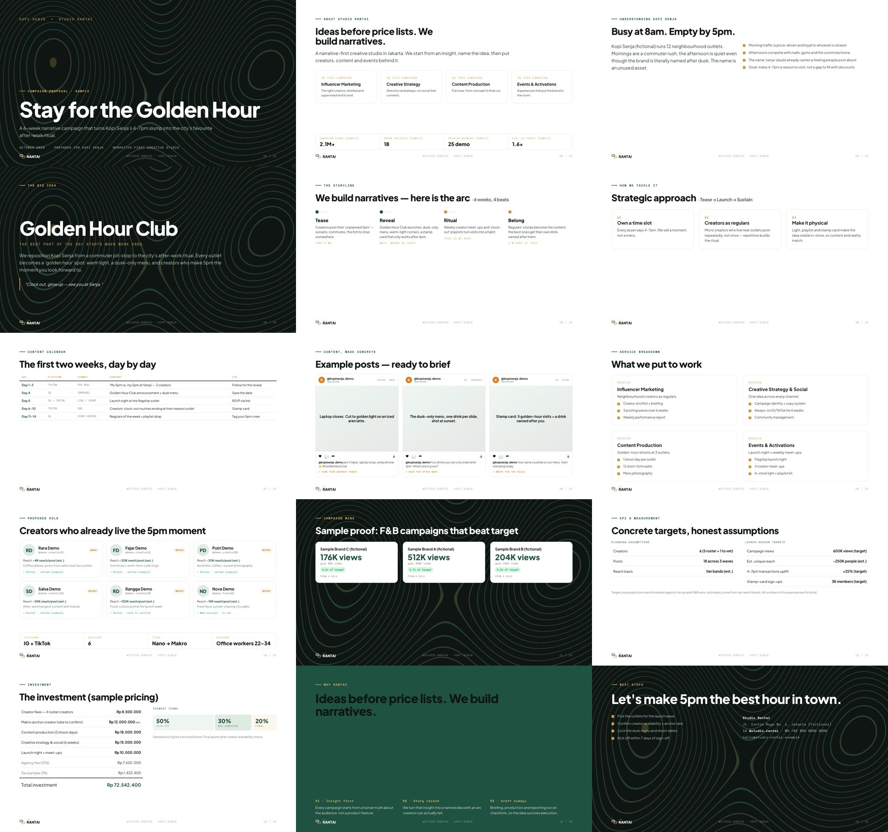
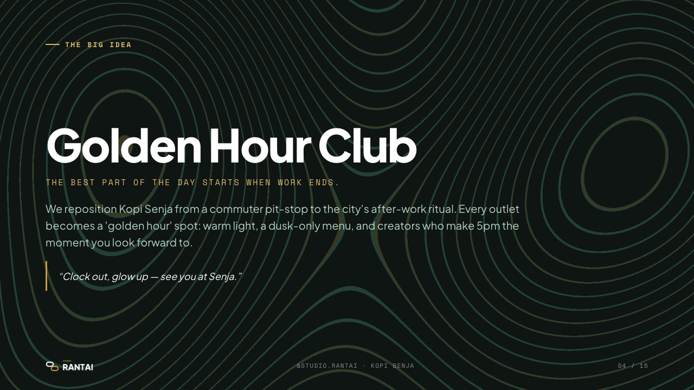
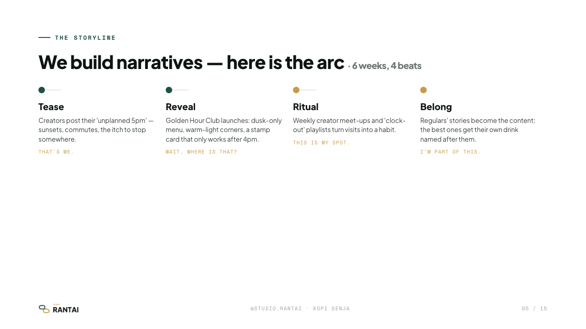
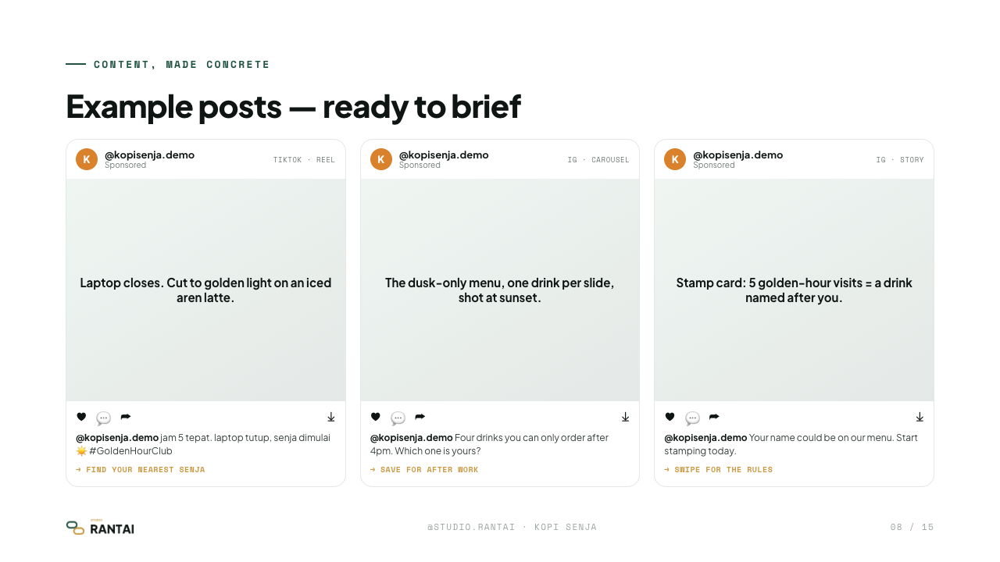
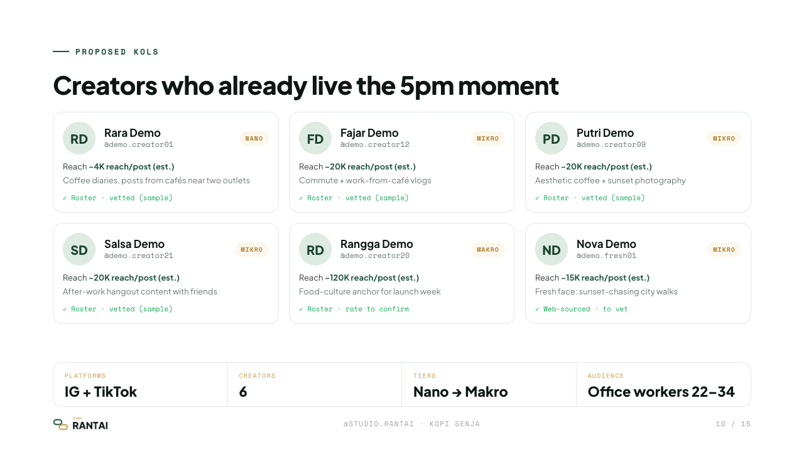
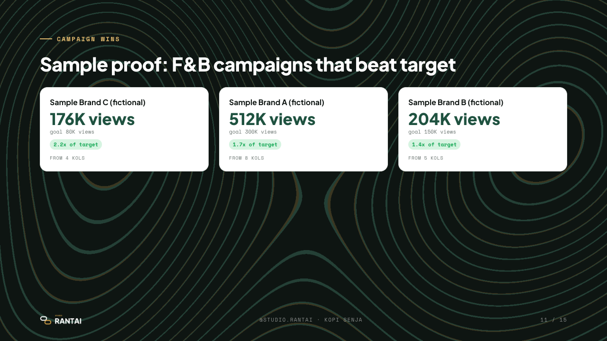
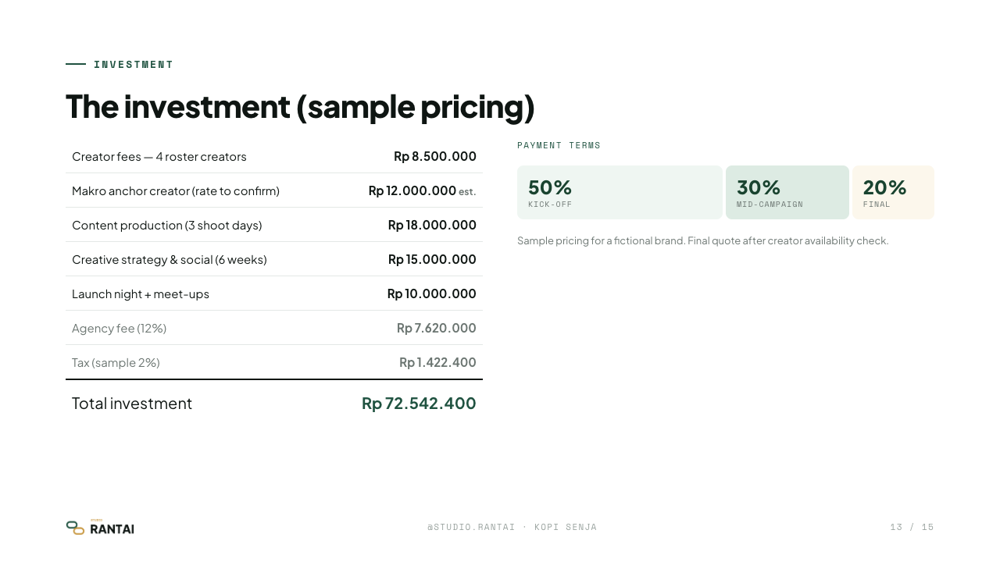

# Deck the Builder

**An AI proposal factory for a creative agency.** You type `/pitch <Brand>` in Claude Code, paste
your meeting notes (or don't), and get back a tailored campaign proposal: a send-ready **PDF**, a
**PPTX** that matches it, a **Canva-editable PPTX** and a **1-page brief**. Every number in it is
labelled as verified, estimated or a target, and the deck gets validated before anyone sees it.



> **About this repo:** I originally built this for a real Jakarta creative agency, where it
> produced 15+ client proposals. This public version runs on a fictional agency (*Studio Rantai*),
> a fictional client (*Kopi Senja*) and sample data. All creators, campaigns, prices and contact
> details here are invented.

---

## The problem

The agency pitched new brands every week, and each deck took **days** of senior time:

- **Slow.** Research, a concept, a strategy, a creator shortlist, pricing and 15+ designed slides,
  all rebuilt by hand for every client.
- **Inconsistent.** Quality depended on who built the deck and how much time they had. Old decks
  had plain-text creator lists, placeholder images repeated across slides, broken tables of
  contents and missing investment slides.
- **Risky.** If you ask an LLM to "make a pitch deck", it will make up reach numbers, creator rates
  and past results with total confidence. If an invented "3.2M views" lands in front of a client,
  the agency loses trust.

The goal was to get a deck in hours instead of days, keep the agency's narrative-first quality,
and make it structurally impossible to print a guess as a fact.

## The `/pitch` pipeline

```mermaid
flowchart LR
    A[/"/pitch Brand<br/>+ meeting notes?"/] --> B[Intake<br/><i>skill</i>]
    B --> C[Researcher<br/><i>subagent, read-only</i>]
    C --> D[Brainstorm<br/>2–3 named concepts]
    D --> E{{"⏸ Human picks<br/>the concept"}}
    E --> F[Strategy<br/>phases · KPIs · budget]
    F --> G[Talent<br/>query_roster.py]
    G --> H[Designer<br/><i>subagent</i><br/>writes deck.json]
    H --> I[verify_outputs.py<br/>schema · provenance · PII]
    I -->|pass| J[build_deck → PDF<br/>PPTX · Canva PPTX · brief]
    I -->|fail| H
    J --> K[Proposal review<br/>checklist, P1 blocks]
```



1. **Intake** turns messy notes into a structured brief: objective, budget signals, timeline,
   must-haves, open questions. With no notes it runs in *cold mode* and says so.
2. A **researcher subagent** (read-only) covers the brand, category, audience and competitor moves,
   finds dated trends and fresh creators. Every claim is marked `verified` or `inferred`.
3. **Brainstorm** comes up with 2–3 distinct, named concepts, each with an insight, a hook and a
   service mix.
4. **Concept gate.** The pipeline stops here until a human picks a direction. No full deck gets
   built on an idea nobody approved.
5. **Strategy, then talent.** `query_roster.py` shortlists creators from the vetted roster and
   attaches *verified* past results in the same category as proof.
6. A **designer subagent** writes `deck.json`, the only thing the model writes. Deterministic
   tools render everything else.
7. **Verify + review.** `verify_outputs.py` has to pass, then a by-eye checklist runs. Any P1 issue
   blocks hand-off.

## Architecture: WAT (Workflows · Agents · Tools)

| Layer | Where | Responsibility |
|---|---|---|
| **Workflows** | `.claude/commands/pitch.md`, `.claude/skills/*` (11 SOPs) | Plain-language procedures: what to produce, which tool to run, the rules |
| **Agents** | the orchestrator + `.claude/agents/{researcher,designer}.md` | Judgement: insight, narrative, copy, sequencing, recovering from failures |
| **Tools** | `tools/*.py` (12 scripts, 30 tests) | Everything that has to be exact: rendering, money formatting, roster filtering, validation |

If each model-driven step is 90% reliable, five chained steps end up around 59%. So the model only
writes **content** (`deck.json`). Layout, typography, IDR formatting, number labels, PDF/PPTX output
and validation are all ordinary tested Python. More in [`docs/WAT.md`](docs/WAT.md).

```
deck.json ──► build_deck.py (Jinja2 + tokens.css + inlined fonts/logo) ──► deck.html
                                                                         ├─► html_to_pdf.py ─► deck.pdf
                                                                         ├─► build_pptx.py  ─► deck.pptx        (pixel-matched)
                                                                         └─► to_canva.py    ─► deck.canva.pptx  (native shapes, editable)
deck.json ──► build_brief.py ──► brief.md
```

## Trust features

**1. Number provenance.** Any metric claim in `deck.json` is an object with a required tag:

```json
{"value": 20000,  "provenance": "estimate", "unit": "reach/post"}   →  ~20K reach/post (est.)
{"value": 600000, "provenance": "target",   "unit": "views"}        →  600K views (target)
{"value": 512000, "provenance": "verified", "unit": "views"}        →  512K views
```

One function (`_util.fmt_stat`) decides how each kind renders, so no template can show an
estimate as a fact. `verify_outputs.py` fails the build if a metric object has no tag. A test
renders all three kinds to HTML and checks the labels made it onto the page.

**2. Schema validation.** `schema/deck.schema.json` (JSON Schema 2020-12) is the contract every
deck must satisfy. The verify gate also rejects leftover placeholders (`[[…]]`, `TODO:`,
`lorem ipsum`), slide types the renderer doesn't support, moodboards with no images that resolve,
and PDF/PPTX files that aren't valid.

**3. PII guard.** Agency talent spreadsheets mix public profile data with payout details.
`import_roster.py` writes only an **allowlist** of public columns and refuses files that are
named like bank or payout exports. The shipped sample input really does include fake `bank_name`,
`bank_account` and `phone` columns. The tool strips them and says so:

```
$ ./run.sh tools/import_roster.py
Imported 25 unique creators from 27 source rows -> data/roster/kols.csv
  with a known rate: 20 | rest have rate_idr blank (to confirm, never invented)
  PII columns stripped (never written): bank_name, bank_account, phone
```

Tests check that none of those values show up in the output and that the committed roster header
is exactly the allowlist.

**4. Concept-confirmation gate.** The pipeline won't build a full deck until a human has picked
the idea (step 4 above). The machine drafts and a person decides.

**5. No invented rates.** Creator rates come from the roster or stay blank ("rate to confirm").
Tier reach bands are reference ranges and always render as `est.`.

## Outputs: the Kopi Senja example

[`examples/kopi-senja/`](examples/kopi-senja/) is a full cold-mode pitch for a fictional coffee
chain. The idea is **"Golden Hour Club"**: turn the chain's empty 4–7pm slot into an after-work
ritual. It contains `deck.json` (the source), [`deck.pdf`](examples/kopi-senja/deck.pdf),
`deck.pptx`, `deck.canva.pptx` and [`brief.md`](examples/kopi-senja/brief.md), all produced by
the tools in this repo.

| | |
|---|---|
|  |  |
| **Cover:** client × agency lockup, campaign theme | **The Big Idea:** named, with tagline, narrative and hook |
|  |  |
| **Storyline:** the campaign as a four-beat arc | **Example posts:** ready-to-brief captions in the brand's voice |
|  |  |
| **Creator cards:** roster + one fresh to-vet face; reach labelled `est.` | **Proof:** verified past results matched by category (sample data) |
|  | |
| **KPIs:** `target` and `est.` labels rendered next to the numbers | |

The agency is swappable. Brand identity lives in `config/brand.json` and `templates/tokens.css`,
and templates only refer to role colours (`--primary-*`, `--accent-*`). The wordmark and the
topographic texture are generated from code by `tools/make_brand_assets.py`. To re-skin the
factory, edit two files and re-run one script.

## Quickstart

Requires Python 3.12 and macOS or Linux.

```bash
git clone <this repo> deck-the-builder && cd deck-the-builder
python3.12 -m venv .venv
./.venv/bin/pip install -r requirements.txt
./.venv/bin/python -m playwright install chromium

./.venv/bin/python -m pytest tests/ -q        # 30 tests
./scripts/build_example.sh                    # rebuild the Kopi Senja deck end to end
```

Try the tools on their own:

```bash
./run.sh tools/query_roster.py --keyword coffee --category fnb --available --table
./run.sh tools/new_proposal.py "Your Brand" --title "Your Campaign" --accent "#3366FF"
./run.sh tools/verify_outputs.py proposals/your-brand/deck.json
```

The full agent pipeline needs [Claude Code](https://claude.com/claude-code). Open the repo and run
`/pitch <Brand>`. Output goes to `proposals/<slug>/`, which is gitignored on purpose.

## Repo map

```
.claude/
  commands/pitch.md          the orchestrator pipeline
  agents/                    researcher (read-only) + designer subagents
  skills/                    agency-brand, proposal-structure, meeting-notes-intake, brainstorm,
                             strategy, talent-roster, competitive-research, content-design,
                             deck-build, proposal-review, canva-handoff
tools/                       deterministic Python (render, verify, roster, brief, brand assets)
config/                      brand.json, services, tiers, sample pricing, sample campaigns, deck order
schema/deck.schema.json      the deck contract
templates/                   tokens.css, deck.css, Jinja2 slide macros (28 slide types)
data/roster/                 fictional raw export (with fake PII) → cleaned roster
examples/kopi-senja/         the rendered demo proposal
tests/test_tools.py          30 tests: money, slugs, provenance, PII strip, verify gate, rendering
```

## Licence

Code: MIT © 2026 Michael Kurnia. Fonts (Plus Jakarta Sans, Space Mono): SIL Open Font License
1.1, see [`assets/fonts/OFL-NOTICE.md`](assets/fonts/OFL-NOTICE.md).
